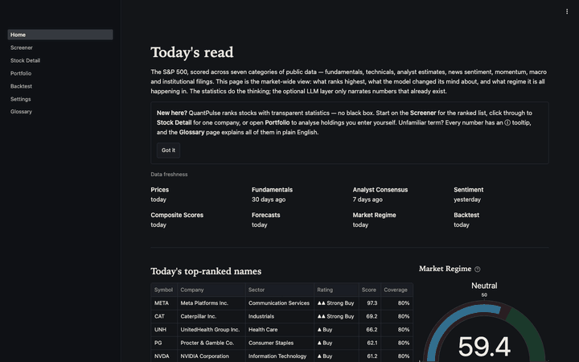
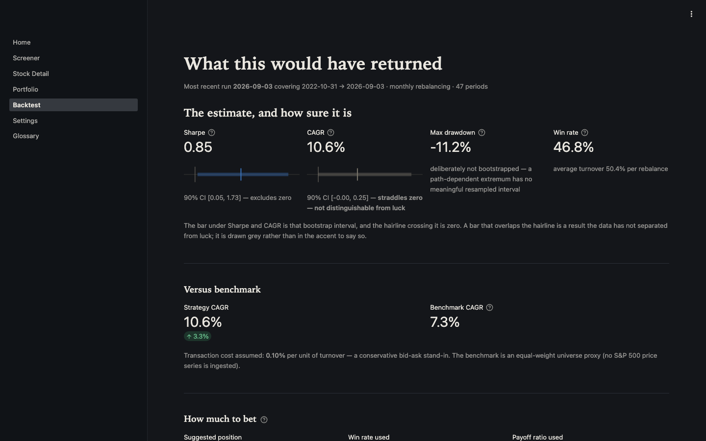
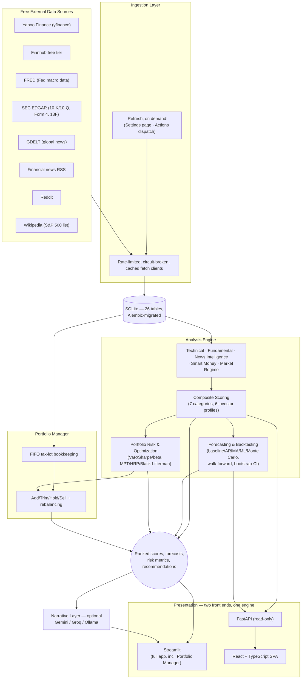

# QuantPulse

[](https://github.com/MarlenMM/quantpulse/actions/workflows/ci.yml)
[](https://marlenmm.github.io/quantpulse/)
[](tests/)
[](.python-version)
[](LICENSE)

**A self-hosted, $0 equity-research and portfolio-construction engine for the S&P 500.**
Statistics and ML do the ranking, forecasting and risk work; a free-tier LLM only
narrates results that already exist. Backtests report their uncertainty, forecasts
are graded against a random walk before they are shown, and every gap in the free
data is labelled rather than hidden.

- **[Live demo](https://marlenmm.github.io/quantpulse/)**: the research front end (React + TypeScript). No sign-up, no keys, and it works on a phone.
- **[Full app](https://quantpulse-demo.streamlit.app)**: all seven Streamlit pages, including the Portfolio Manager with its optimisers, rebalancing and history. It sleeps when idle, so the first visit takes a minute.
- **Run it locally:** `./run.sh`. One command, no API key, no account. [HOW_TO_USE.md](HOW_TO_USE.md) is a plain-English guide to both front ends and to which numbers on screen are solid and which are thin.



*Screenshots use synthetic data run through the real scoring, forecasting and backtest pipeline; [docs/screenshots/README.md](docs/screenshots/README.md) explains how, and why never against real API data.*

## By the numbers

| | |
|---|---|
| Automated tests | **2,000+** (unit, integration, and property-based via Hypothesis), plus two Playwright suites: one against a stubbed API, one against the real pre-rendered site |
| Core engine code | **21,000+** lines (`src/quantpulse/`) — ingestion, analysis, storage, API |
| Free data sources integrated | **8** feed each refresh — Yahoo Finance, Finnhub, FRED, SEC EDGAR (filings + 13F), GDELT, Reddit, financial news RSS, Wikipedia — plus a 9th (a historical S&P 500 constituents dataset) used only for the one-time cold-start backfill |
| Database | **26 tables**, **19 Alembic migrations**, every one reversible (`alembic downgrade` round-trips clean) |
| Composite scoring | **7 categories** (fundamentals, technicals, analyst consensus, news sentiment, momentum, industry/macro, smart money) × **6 investor-profile presets** — four differ by category weights alone, and two (income, conservative) genuinely re-score a category, so each refresh stores their rankings separately |
| Chart pattern families detected | **4** — head-and-shoulders, double top/bottom, triangles/wedges/channels, cup-and-handle — detected across the whole universe on every refresh and shown per stock with a confidence score |
| Forecasting approaches | **4** — random-walk baseline, ARIMA/SARIMA, gradient-boosted ML, and a Monte Carlo fan chart. The first three are graded out-of-sample against the naive baseline; Monte Carlo deliberately is not, because it simulates the same random walk the baseline evaluates in closed form (grading it would be grading the baseline against itself) |
| Backtest confidence | Sharpe & CAGR reported with **moving-block bootstrap** confidence intervals, never a bare point estimate |
| Portfolio optimization methods | **3** — mean-variance (MPT), Hierarchical Risk Parity, and Black-Litterman driven by the app's own composite scores, each with a concrete buy/sell trade list |
| Front ends | **2** — a 7-page Streamlit app (full app, incl. Portfolio Manager and the LLM narration layer) and a 6-page React + TypeScript SPA over a 15-endpoint read-only FastAPI. The two share every number: both read the same `storage.persistence` functions, the React screener's client-side re-weighting was checked against Streamlit's across all 503 names, and the numbers a stock shows on both (beta, Sharpe, Sortino, forecast prices, Kelly size) are asserted equal by test. The SPA omits the LLM narration and the Portfolio Manager's optimisers, rebalancing and history; its Portfolio page (FIFO lots, P/L, per-holding suggestions, concentration, risk) runs in the browser and is pinned to the engine's own results by a golden-file test in both languages |
| Glossary terms | **74**, across 8 categories — one definition shared by every tooltip and both front ends |
| Required budget | **$0** — every data source, model, and hosting option used is free-tier or open-source |

## What it does

| Page | What it shows |
|---|---|
| **Dashboard** | Market Regime Index gauge, top-ranked names, what changed since the last refresh, sector rotation, market-moving Tier-2/3 news |
| **Screener** | The ranked, filterable table, with sliders that re-weight the seven score categories *and re-rate against them* client-side, a relative/absolute rating-scheme switch, and a 2–4 ticker Compare mode |
| **Stock Detail** | Price chart with support/resistance and detected patterns, sub-score radar, forecast fan chart with each model's own hit-rate *and the number of windows behind it* (forecasts run 5 and 20 trading days ahead — the 63- and 252-day horizons were dropped because three and a half years of history cannot grade them — and any row without a measured accuracy sits behind its own disclosure rather than beside the graded ones), Monte Carlo paths, per-stock risk block, short interest read both ways, sector macro overlay, news feed, optional plain-English summaries of the sentiment move and the latest SEC filing, and a chat box grounded strictly in that stock's computed numbers |
| **Portfolio & Watchlist** | FIFO tax-lot positions, risk dashboard (vol/Sharpe/Sortino/beta/VaR/correlations + correlation clusters), a target allocation from any of the three optimizers with its concrete trade list, Add-Trim-Hold-Sell guidance, concentration + sector-gap warnings |
| **Backtest / Track Record** | Sharpe and CAGR with bootstrap confidence intervals, benchmark comparison, stated cost assumptions — and the ranking signal named, with what it is *not* spelled out |
| **Settings / About** | Data freshness per dataset, pipeline health, configuration, methodology and limitations |



## Architecture



**Data flow in one sentence:** free APIs feed a scheduled ingestion job → normalized data lands in SQLite → a stack of independent, testable analysis modules score every stock on several dimensions → the scores combine into one ranking, a forecast, and portfolio-level guidance → two front ends display it, optionally narrated in plain English by a free-tier LLM. See [ARCHITECTURE.md](ARCHITECTURE.md) for the module-by-module tour.

**Two front ends, one engine.** The analysis engine never imports from a UI, which
is what lets the Streamlit app and the React SPA share every number without
duplicating a line of analysis: both read the same `storage.persistence`
functions, and tests assert that the figures they both show are equal. The
FastAPI layer is deliberately **read-only**: portfolio state is per-user, so the
full Portfolio Manager stays in Streamlit, and the SPA's Portfolio page keeps its
transaction log in the browser's `localStorage` (a test asserts the client only
ever issues plain GETs).

## Methodology guardrails

The engine is built around the mistakes that make a stock screener look better
than it is:

- **No look-ahead.** Every feature is trailing-only, forecasts predict forward
  *returns* rather than price levels, and the backtest is walk-forward.
- **Point-in-time universe.** `index_membership_history` records who was in the
  S&P 500 on each date, so a company that later went bankrupt is in the 2019
  rebalance and realises its loss.
- **Uncertainty, not point estimates.** Sharpe and CAGR come with moving-block
  bootstrap confidence intervals, and a track record too short to annualise is
  shown as a total return over a stated window.
- **Baselines first.** ARIMA/SARIMA and gradient boosting are graded
  out-of-sample against a random-walk baseline, and each forecast shows its own
  hit rate and the number of windows behind it.
- **Missing is not zero.** A category with no data is dropped from the weighting
  and the score is renormalised over what remains, at a lower `data_confidence`
  that every page displays.
- **A forward test the backtest cannot fake.** With paper-trading keys set, the
  published rating is traded forward every week, so its record accrues from
  positions chosen before the outcome was known.

### Known limitation: survivorship coverage of delisted companies

The backtest is built to be survivorship-bias-free: `index_membership_history`
records point-in-time index membership, so a company that was in the S&P 500 in
2019 and later went bankrupt is *in* the 2019 rebalance and realises its loss
rather than vanishing from history.

That machinery only helps if those companies have **prices**. They largely
don't. On a real full backfill, price history was available for **98.8% of
current members but only 49% of delisted ones** — free sources simply do not
carry most long-dead tickers. `seed_initial_data.py` measures this and reports
status `partial_survivorship_gap` when coverage falls below 50%, rather than
letting it pass silently.

**What this means when reading a backtest result here:** the losers are
under-represented, so the track record is flattered by an unknown amount. The
membership data is honest; the price coverage behind it is partial. This is
stated rather than engineered around because no amount of code fixes a source
that doesn't have the data (Section 22: an honestly-labelled limitation beats a
silently inflated number).

A related data-quality note: adjusted-close history for long-delisted names is
frequently corrupt — one real example moved from $0.005 to $305.00 in a single
bar. `read_adj_close_panel` drops any symbol containing a greater-than-10x
bar-to-bar move, since a broken adjustment factor corrupts the whole series it
scales. On the real universe this removed 26 of 825 symbols, and that count did
not grow when the panel expanded by 330 names.

## How QuantPulse compares

Positioned deliberately, not as a like-for-like competitor to a commercial
screener — see [Section 2 of the plan](PROJECT_PLAN.md#2-scope-what-this-is-and-isnt)
for the full, honest list of what's explicitly out of scope:

| | QuantPulse | Finviz / TradingView (free tiers) |
|---|---|---|
| Cost | $0, always | Free tier, paywall for the deeper screens/alerts |
| Ranking methodology | Fully transparent — read the actual scoring source | Proprietary/opaque |
| Backtesting | Built in: walk-forward, bootstrap-confidence-interval-aware | Not available on free tiers |
| Portfolio-level guidance | Add/Trim/Hold/Sell + concentration/sector-gap warnings | Watchlists only, no guidance |
| Data cadence | Batch, refreshed when you ask it to, by design (Section 2) — a research tool, not a ticker tape | Real-time |
| Coverage | US equities & ETFs, S&P 500 universe | Global, much broader |
| News/sentiment | 3-tier (company/industry/market), scored by a local FinBERT model | Headlines only, no built-in scoring |

The honest trade: QuantPulse gives up real-time breadth and global coverage
for full transparency, built-in backtesting rigor, and portfolio-specific
guidance a free screener doesn't offer.

## Quickstart

```bash
# 1. Install uv (https://docs.astral.sh/uv/) if you don't have it
brew install uv

# 2. Install dependencies (creates .venv automatically, pinned to Python 3.12)
uv sync

# 3. Configure environment
cp .env.example .env
# edit .env with your own API keys (all free-tier; see .env.example for where to get each one)

# 4. Apply database migrations (alembic.ini lives at the repo root)
uv run alembic upgrade head

# 5. Run the test suite
uv run pytest

# 6. Launch the app (works against an empty database — it tells you how to populate it)
uv run streamlit run app/Home.py
```

**React + FastAPI**, in two terminals:

```bash
uv run uvicorn quantpulse.api.main:app --reload   # API on :8000, docs at /docs
cd frontend && npm install && npm run dev          # SPA on :5173, proxies /api
```

### Populating it with real data

```bash
uv run python scripts/seed_initial_data.py   # one-time historical backfill (slow)
uv run python scripts/refresh_data.py        # incremental refresh + scoring (also a button in the app)
```

The backfill takes a few hours for the full ~1,200-symbol universe and is
resumable — it infers progress from the database, so re-running it continues
rather than starting over. Expect roughly 300 MB.

**Your own database refreshes when you ask it to** — from **⚙️ Settings → Run a
refresh** in the app (the usual way: it runs in the background and tails its own
log while you keep using the app) or by running the script above. The *public
demo* is different and runs on a timer; see [Data and secrets](#data-and-secrets).

Three things are worth knowing before you start one by hand, and the page offers
a checkbox for the last two:

- **Run it after the US close.** Earlier and the day's closing prices and option
  chain simply have not been published yet.
- **The weekly branch keys off Monday.** Fundamentals, analyst consensus, 13F,
  forecasts, the backtest, news and sentiment only run then, so tick *Include the
  weekly steps* to refresh them on any other day. That run takes hours rather
  than minutes.
- A refresh is a deliberate no-op on a weekend or holiday unless you tick *Run
  even though the market is closed today*.

## Testing and quality

- **2,000+ Python tests**: unit, integration, and property-based tests with
  Hypothesis for the invariants that matter: scores bounded and monotonic,
  missing categories dropped rather than scored as zero, FIFO lots conserving
  shares and cost basis, bootstrap intervals reproducible from a seed.
- **Two Playwright suites**: one against a stubbed API, one against the real
  pre-rendered site, which the publish workflow runs before the demo updates.
- **Golden files across languages**: the SPA's TypeScript port of the portfolio
  rules is pinned to the Python engine's own output.
- **Docs that cannot drift**: `tests/unit/test_documented_counts.py` derives the
  counts in this README (tests, tables, migrations, endpoints, pages, glossary
  terms) from the code and fails when they disagree.
- **Static checks**: `ruff`, `ruff format` and `mypy` in CI and in pre-commit;
  `npm run typecheck` and `npm audit` for the client; Dependabot for both.

## Documentation

| Document | What it covers |
|---|---|
| [HOW_TO_USE.md](HOW_TO_USE.md) | Plain-English guide for a user of either front end |
| [ARCHITECTURE.md](ARCHITECTURE.md) | A short, code-first tour of how the repository is laid out |
| [PROJECT_PLAN.md](PROJECT_PLAN.md) | The original design plan: data sources, scoring methodology, ADRs, risk ratings per component |
| [docs/OPERATIONS.md](docs/OPERATIONS.md) | Deployments, the nightly refresh, secrets, alerts, the forward test, and engineering notes |
| [docs/IMPROVEMENT_BACKLOG.md](docs/IMPROVEMENT_BACKLOG.md) | Two product audits (49 findings), how each fix was verified, and the traps that cost real time |
| [CONTRIBUTING.md](CONTRIBUTING.md) | Development set-up and conventions |

## Development

- Lint/format: `uv run ruff check .` / `uv run ruff format .`
- Type-check: `uv run mypy src scripts app`
- Enable git hooks (ruff + mypy on every commit): `uv run pre-commit install`
- Contributing: see [CONTRIBUTING.md](CONTRIBUTING.md).

## Disclaimer

**Educational/research tool. Not financial advice. Not a registered investment advisor. Past backtested performance does not guarantee future results.**

Code: [MIT](LICENSE). Data comes from each source under its own terms.
